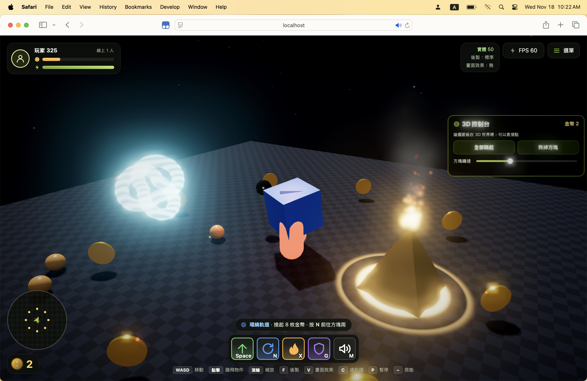
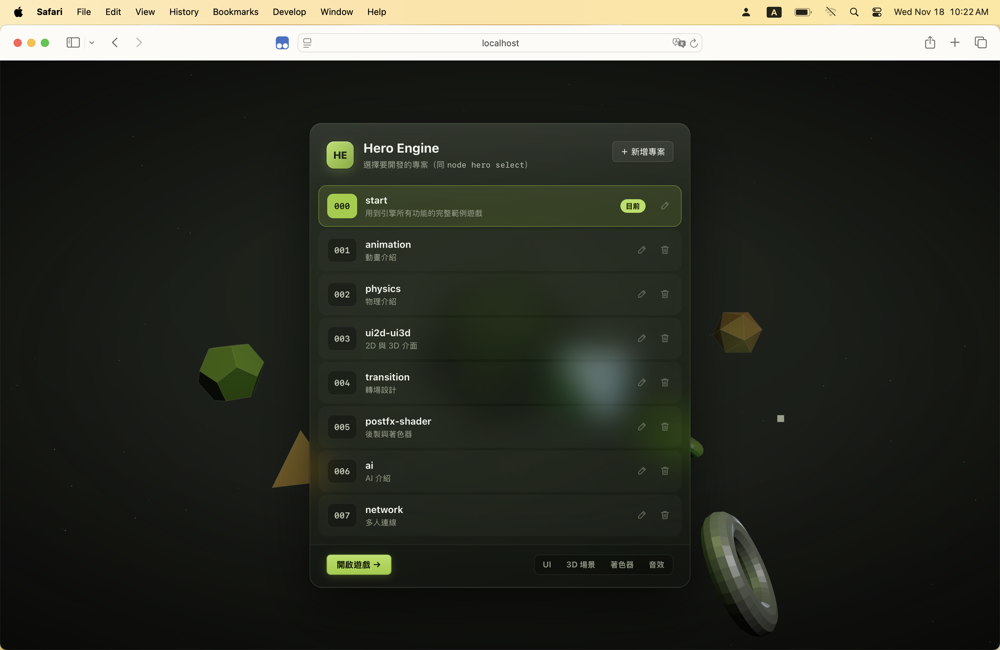
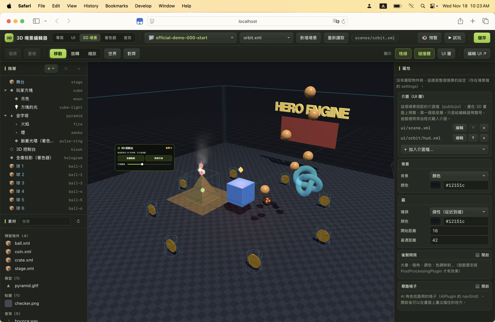
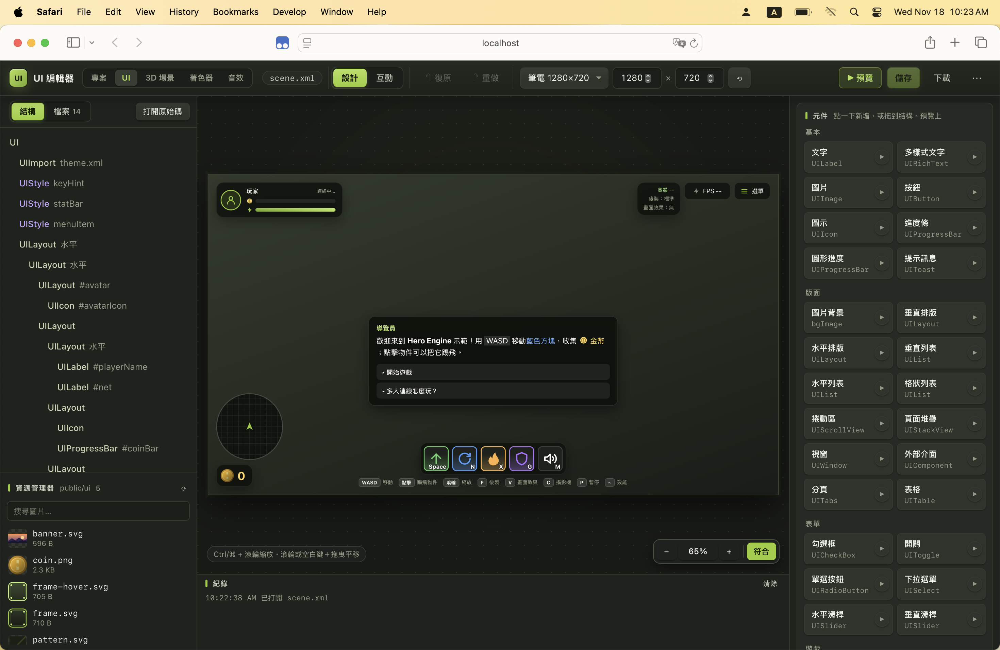
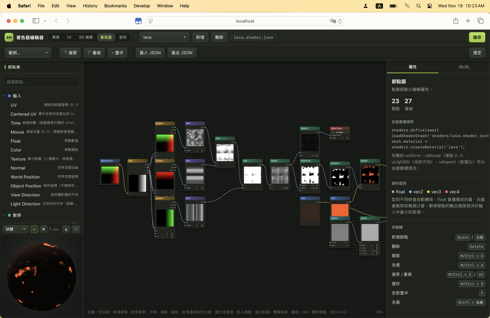
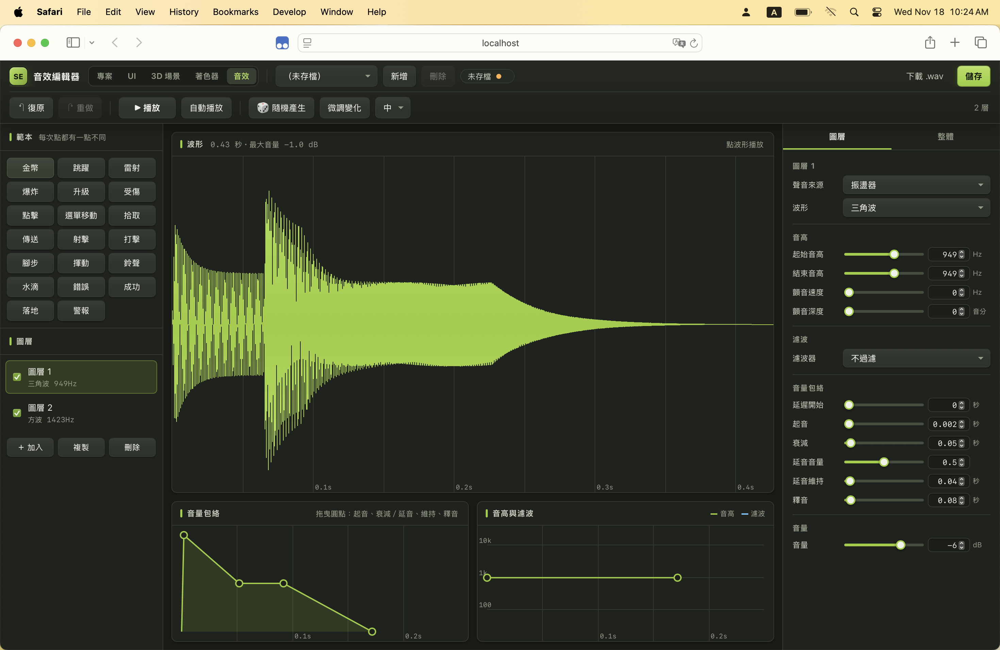

# Hero Engine

HERO 遊戲引擎 = Threejs 繪圖引擎 x Claude 引擎實作 x William77 組織與規劃

以 TypeScript 撰寫、建立在 [three.js](https://threejs.org/) 之上的網頁 3D 遊戲引擎。採用 ECS（實體、元件、系統）架構，功能以外掛形式組合，內建場景、介面、著色器與音效編輯器，遊戲可以發佈成網頁版或 macOS App。

**免費開源**：採用 [MIT 授權](LICENSE)，可以自由使用、修改、散布，也可以用來製作商業遊戲。








## 功能

| 模組                 | 說明                                                                                    |
| -------------------- | --------------------------------------------------------------------------------------- |
| `core`               | 引擎主體、外掛系統、遊戲迴圈                                                            |
| `ecs`                | 實體、元件、系統、資源                                                                  |
| `scene`              | 父子關係、Transform、場景檔（XML）與預製物件                                            |
| `render`             | 繪製、陰影、動態解析度、繪製圖層                                                        |
| `postfx` / `shaders` | 後製效果、自訂著色器與節點圖材質                                                        |
| `animation`          | 補間、時間軸、動畫狀態機                                                                |
| `physics`            | 物理（[Rapier](https://rapier.rs/)）                                                    |
| `particles`          | 粒子系統                                                                                |
| `audio`              | 音效與 3D 音效                                                                          |
| `input`              | 鍵盤、滑鼠、觸控、按鍵綁定                                                              |
| `assets`             | 資源載入與管理                                                                          |
| `scripts`            | 掛在實體上的腳本                                                                        |
| `ai`                 | 行為樹、狀態機、找路（NavGrid）、轉向、感知                                             |
| `ui2d` / `ui3d`      | 2D 介面（XML、[Yoga](https://www.yogalayout.dev/) 排版、RWD、小地圖）與 3D 空間中的介面 |
| `text3d`             | 3D 文字                                                                                 |
| `network`            | 多人連線（WebSocket，搭配轉送伺服器）                                                   |
| `plugins`            | 套件管理（`PluginManager`），例如 `@engine/packages/perf-monitor`                       |

## 需求

- Node.js（建議 v20 以上）
- 發佈 macOS App 時另外需要 macOS 與 [Rust](https://rustup.rs)

## 快速開始

```sh
npm install
node hero dev          # 預覽目前選擇的專案（預設 official-demo-000-start）
```

開發伺服器啟動後可以開啟：

| 網址             | 用途                         |
| ---------------- | ---------------------------- |
| `/`              | 遊戲畫面                     |
| `/portal`        | 入口頁：切換、新增、刪除專案 |
| `/s3d-editor`    | 3D 場景編輯器                |
| `/ui-editor`     | 2D 介面編輯器                |
| `/shader-editor` | 著色器編輯器                 |
| `/se-editor`     | 音效編輯器                   |

## 專案指令（`node hero`）

```sh
node hero create <專案名稱>   # 建立空專案 projects/<專案名稱>/
node hero select [專案名稱]   # 選擇要預覽、編譯的專案（不給名稱時列出所有專案）
node hero remove <專案名稱>   # 刪除專案（需輸入名稱確認，無法復原）
node hero dev                 # 預覽目前選擇的專案
node hero build [--web|--mac] # 檢查後發佈：網頁版（預設）或 macOS App（--mac -f：打開時全螢幕）
node hero doc [build]         # 開啟使用手冊；build 打包到 dist/doc/
node hero api                 # 產生引擎的 API 列表（tips/api.txt）
```

- 專案名稱只能用小寫英文、數字和連字號（`-`），並以英文或數字開頭。
- `dev`、`build` 後面的其他參數會交給 Vite，例如 `node hero dev --port 3000`。
- 暫時改用別的專案：`PROJECT=名稱 node hero dev`。

### 發佈

`node hero build` 會依序執行格式與程式檢查（Biome）、型別檢查（tsc）、測試（Vitest），全部通過才打包：

| 參數            | 輸出                                                                                                      |
| --------------- | --------------------------------------------------------------------------------------------------------- |
| `--web`（預設） | `dist/<專案名稱>/web/`                                                                                    |
| `--mac`         | `dist/<專案名稱>/mac/<專案名稱>.app`（以 [Tauri](https://tauri.app/) 包裝；第一次編譯 Rust 套件會比較久） |
| `--mac -f`      | 同上，App 打開時就是全螢幕（`-f` 同 `--fullscreen`；玩家可以按 ⌃⌘F 離開）                                |

macOS App 的圖示：專案目錄放 `icon.png`（建議 1024×1024）就會使用，否則用引擎預設圖示。

## npm scripts

```sh
npm run dev        # 同 node hero dev
npm run build      # 同 node hero build
npm run typecheck  # 型別檢查
npm test           # 執行測試（Vitest）
npm run lint       # 程式檢查（Biome）
npm run format     # 格式化
npm run fix        # 自動修正格式與可修正的問題
npm run check      # CI 用的完整檢查
npm run relay      # 啟動多人連線的轉送伺服器（預設連接埠 8787，可用 PORT 改）
npm run doc        # 同 node hero doc
```

## 撰寫遊戲

每個遊戲是 `projects/` 底下的一個專案：

```
projects/<專案名稱>/
├── index.html              頁面（<title> 也是 macOS App 的視窗標題）
├── tsconfig.json           沿用根目錄設定，單獨開啟資料夾時也有程式碼提示
├── src/
│   ├── engine.ts           引擎與外掛設定（要用哪些外掛）
│   └── main.ts             遊戲程式
└── public/
    ├── scenes/main.xml     場景檔（3D 場景編輯器）
    └── ui/scene.xml        介面檔（UI 編輯器）
```

引擎從 `@engine` 引用，可以用總入口，也可以分模組引用：

```ts
import * as hero from '@engine';
import { Engine } from '@engine/core';
import { RenderPlugin } from '@engine/render';

const engine = new Engine({ debug: import.meta.env.DEV });
engine.use(new RenderPlugin({ shadows: true }));
```

外掛依照順序安裝，有相依的要放在後面。完整寫法可參考 `projects/official-demo-000-start/src/engine.ts`。

### 範例專案

| 專案                              | 內容                           |
| --------------------------------- | ------------------------------ |
| `official-demo-000-start`         | 用到引擎所有功能的完整範例遊戲 |
| `official-demo-001-animation`     | 動畫                           |
| `official-demo-002-physics`       | 物理                           |
| `official-demo-003-ui2d-ui3d`     | 2D／3D 介面、UICanvas 畫布     |
| `official-demo-004-transition`    | 場景轉場                       |
| `official-demo-005-postfx-shader` | 後製與著色器                   |
| `official-demo-006-ai`            | AI                             |
| `official-demo-007-network`       | 多人連線                       |

## 目錄結構

```
.
├── hero.js            專案指令（node hero ...）
├── src/               引擎原始碼（各模組、套件 packages/、編輯器 editors/）
├── projects/          遊戲專案
├── tests/             測試（Vitest）
├── doc/               使用手冊（範例可以直接編輯、執行；見 doc/README.md）
├── tools/             Vite 外掛、專案範本、Tauri 外殼、API 產生工具
├── server/relay.mjs   多人連線的轉送伺服器
├── tips/              API 列表等參考資料（不納入版本控制）
└── dist/              發佈輸出（不納入版本控制）
```

## 使用手冊

```sh
node hero doc          # 開啟使用手冊（/manual/）
node hero doc build    # 打包成靜態網站 dist/doc/
```

手冊分成「說明文件」與「API」兩個分頁。API 參考是從引擎原始碼自動產生的，每個 API 都有可以編輯、執行的範例。詳見 [`doc/README.md`](doc/README.md)。

## 授權

Hero Engine 是免費的開源軟體，採用 [MIT 授權](LICENSE)：

- ✅ 可以免費用於個人或商業專案
- ✅ 可以修改、重新散布原始碼
- ✅ 用 Hero Engine 製作的遊戲不需要開源
- 📌 唯一的條件：散布引擎的原始碼或其大部分內容時，要保留 LICENSE 裡的版權聲明與授權條文

軟體依「現狀」提供，不附帶任何保證。

使用的第三方套件各有自己的授權（three.js、Rapier、Yoga、lil-gui 等），請參閱 `node_modules` 中各套件的授權檔。
